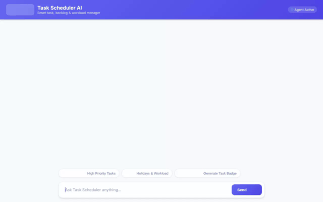

# Task Scheduler AI

An intelligent, conversational task and schedule management assistant built with the **Google Agent Development Kit (ADK)** and **Gemini 2.5 Flash**. Task Scheduler AI helps individuals and teams track to-dos, manage project backlogs, calculate workload metrics, inspect public holidays, and reward progress with AI-generated visual badges and video previews.



---

## 🌟 Key Features & Capabilities

All listed features are fully implemented and wired into the agent's application code in `app/agent.py` and configuration in `agents-cli-manifest.yaml`:

- **🧠 Cross-Session Memory (Vertex AI Memory Bank)**:
  Uses `VertexAiMemoryBankService` coupled with `PreloadMemoryTool` and `generate_memories_callback` to automatically capture, store, and recall user preferences, default work locations, and project contexts across chat sessions.

- **🗄️ Firestore Task Database**:
  Connected directly to Google Cloud Firestore (`tasks` collection) to perform live task management:
  - `search_tasks`: Multi-criteria search by title, category, priority, status, or description.
  - `get_task_details`: Detailed record inspection for specific task IDs.
  - `add_or_update_task`: Instant task creation and status modification.
  - `calculate_workload_and_deadlines`: Calculates active task counts, remaining days, and overdue warnings.

- **📅 Public Holidays Integration**:
  Uses `get_upcoming_public_holidays` to query the Nager.Date Public Holidays API for real-time upcoming holiday schedules by country code (e.g., `US`, `GB`, `CA`).

- **🗺️ Google Maps API Integration**:
  - `geocode_address`: Converts physical addresses or place names into exact latitude/longitude coordinates via Google Geocoding API.
  - `find_nearby_places`: Discovers nearby venues, coffee shops, libraries, or study spots using the Google Places API (New).

- **🎨 Multimodal Image Badge Generation**:
  `generate_task_badge_image` creates custom visual accomplishment icons using `gemini-3.1-flash-lite-image` in the `global` region, saves in-memory artifacts, and publishes images to Google Cloud Storage.

- **🎬 Multimodal Video Preview Generation**:
  `generate_task_preview_video` creates 3D task completion and progress animations using Google's Omni model (`gemini-omni-flash-preview`) in the `global` region, saving artifacts and hosting video files on Google Cloud Storage.

- **☁️ Public Google Cloud Storage Media Hosting**:
  Stores generated badge images and promotional videos in Google Cloud Storage and returns public HTTPS URLs (`https://storage.googleapis.com/...`).

- **🃏 Rich A2UI Card Surfaces**:
  Generates clean, structured UI cards using `A2uiSchemaManager` (v0.8) and `BasicCatalog`, rendering interactive task cards and summary views seamlessly in both `adk web` and custom frontends.

- **🔒 Code Execution Sandbox**:
  Equipped with `AgentEngineSandboxCodeExecutor` for executing python calculations safely in a sandboxed environment.

- **🌐 FastAPI Proxy & Customized Chat Frontend**:
  Includes a lightweight FastAPI proxy (`frontend/main.py`) translating the Agent-to-Agent (A2A) protocol into a modern chat UI (`frontend/static/index.html`) featuring tailored example prompt chips and theme styling.

---

## 🏗️ Architecture Overview

```
┌─────────────────────────────────────────────────────────┐
│              Browser Chat UI / adk web                  │
└───────────────────────────┬─────────────────────────────┘
                            │ A2A Protocol / HTTP
                            ▼
┌─────────────────────────────────────────────────────────┐
│               FastAPI Proxy (frontend/)                 │
└───────────────────────────┬─────────────────────────────┘
                            │ ADC Auth & JSON-RPC
                            ▼
┌─────────────────────────────────────────────────────────┐
│       Task Scheduler ADK Agent (app/agent.py)           │
│              Model: gemini-2.5-flash                     │
└───────┬──────────────┬──────────────┬─────────────┬─────┘
        │              │              │             │
        ▼              ▼              ▼             ▼
┌──────────────┐┌─────────────┐┌────────────┐┌──────────────┐
│  Firestore   ││  Vertex AI  ││ Google Maps││ Cloud Storage│
│  (tasks DB)  ││ Memory Bank ││ & Holidays ││ (Media Assets│
└──────────────┘└─────────────┘└────────────┘└──────────────┘
```

---

## 🛠️ Project Structure

```
task-scheduler/
├── app/
│   ├── agent.py                 # Core ADK agent, tools, memory callbacks, & A2UI
│   ├── a2ui_utils.py            # A2UI response parser callback
│   └── __init__.py
├── frontend/
│   ├── main.py                  # FastAPI proxy handling A2A protocol & ADC auth
│   ├── requirements.txt         # Frontend dependencies
│   ├── Dockerfile               # Cloud Run container definition
│   └── static/
│       └── index.html           # Rebranded HTML/JS chat UI with A2UI card renderer
├── assets/
│   └── demo.gif                 # Looping demonstration recording
├── agents-cli-manifest.yaml     # Agent deployment manifest
└── project_brief.md             # Initial project planning brief
```

---

## 🚀 Setup & Local Execution Instructions

### Prerequisites

Ensure Python 3.10+ and `uv` or `pip` are installed, and authenticate with Google Cloud:

```bash
gcloud auth login
gcloud auth application-default login
gcloud config set project YOUR_PROJECT_ID
```

### 1. Install Dependencies

```bash
# Install root project dependencies
uv sync

# Install frontend proxy dependencies
cd frontend
uv pip install -r requirements.txt
cd ..
```

### 2. Run Agent Playground (Local ADK Web)

To launch the local ADK Web playground with memory persistence connected:

```bash
uv run adk web . --port 8080 --reload_agents --memory_service_uri=agentengine://YOUR_AGENT_ENGINE_ID
```

### 3. Run Custom Frontend Server Locally

To launch the custom FastAPI proxy and web frontend locally:

```bash
export AGENT_ENGINE_RESOURCE_NAME="projects/YOUR_PROJECT_NUMBER/locations/YOUR_REGION/reasoningEngines/YOUR_RESOURCE_ID"
export AGENT_DIRECTORY="app"
export GOOGLE_CLOUD_PROJECT="YOUR_PROJECT_ID"
export GOOGLE_CLOUD_LOCATION="us-central1"

cd frontend
uv run python main.py
```

---

## ☁️ Deployment Instructions

### Deploy Agent to Agent Runtime (Agent Engine)

```bash
agents-cli deploy \
  --project YOUR_PROJECT_ID \
  --region us-central1 \
  --update-env-vars GOOGLE_MAPS_API_KEY=YOUR_API_KEY
```

### Deploy Frontend Proxy to Cloud Run

```bash
cd frontend
gcloud run deploy task-scheduler-frontend \
  --source . \
  --region us-central1 \
  --project YOUR_PROJECT_ID \
  --allow-unauthenticated \
  --set-env-vars AGENT_ENGINE_RESOURCE_NAME=projects/YOUR_PROJECT_NUMBER/locations/us-central1/reasoningEngines/YOUR_RESOURCE_ID,AGENT_DIRECTORY=app,GOOGLE_CLOUD_PROJECT=YOUR_PROJECT_ID,GOOGLE_CLOUD_LOCATION=us-central1
```

---

## 📋 Project Status

| Feature Area | Status | Implementation Details |
| :--- | :---: | :--- |
| Gemini 2.5 Flash Agent | ✅ Complete | Wired via ADK `Gemini` model provider |
| Vertex AI Memory Bank | ✅ Complete | Active via `PreloadMemoryTool` & callbacks |
| Firestore Task Manager | ✅ Complete | CRUD & workload analysis tools connected |
| Public Holidays Tool | ✅ Complete | Live Nager.Date API integration |
| Geocoding & Nearby Places | ✅ Complete | Google Maps Geocoding & Places API |
| Badge Image Generation | ✅ Complete | `gemini-3.1-flash-lite-image` in `global` |
| Video Animation Preview | ✅ Complete | `gemini-omni-flash-preview` in `global` |
| Cloud Storage Uploads | ✅ Complete | Automatic upload of images & videos |
| A2UI Cards & Summary | ✅ Complete | Schema v0.8 BasicCatalog rendering |
| Code Execution Sandbox | ✅ Complete | `AgentEngineSandboxCodeExecutor` |
| Custom FastAPI Chat UI | ✅ Complete | Responsive chat UI with prompt chips |
